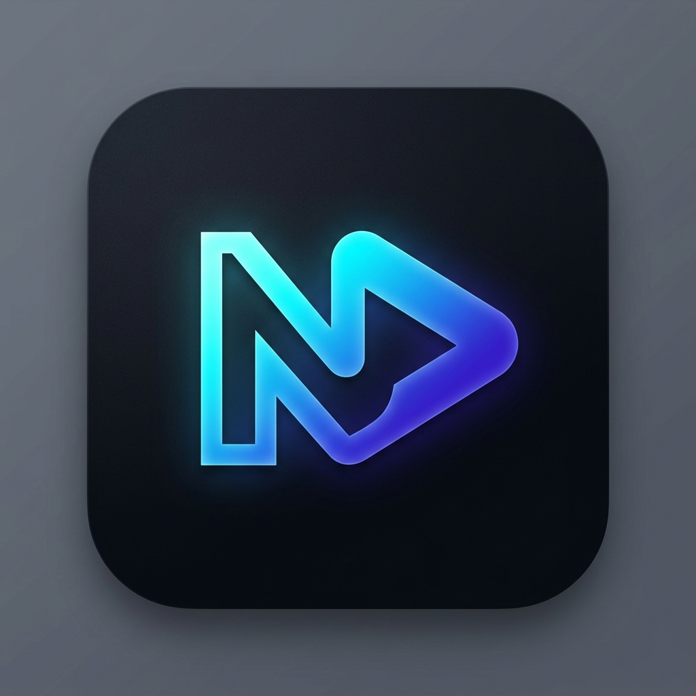

# 🎬 NovaPlayer (Zenora)

<div align="center">



### مشغل وسائط شامل، متقدم، وخزنة سرية فائقة الأمان مبني باستخدام Flutter
### Next-Generation Multimedia Player & High-Security Vault App Built with Flutter

[](https://flutter.dev)
[](https://dart.dev)
[](https://github.com/media-kit/media-kit)
[](#)
[](#)

[العربية](#-عن-المشروع) • [English](#-about-the-project) • [المميزات](#-أبرز-المميزات) • [الهيكلية](#-هيكلية-المشروع) • [التشغيل](#-التثبيت-والتشغيل)

</div>

---

## 📖 عن المشروع (About)

**NovaPlayer (Zenora)** هو تطبيق متكامل لإدارة وتشغيل الوسائط المتعددة (فيديو، صوت، صور) مع نظام حماية وخزنة سرية متقدمة للغاية. صُمم التطبيق ليوفر أداءً خارقاً باستخدام محرك `media_kit` المعتمد على مكتبات FFmpeg و libmpv لدعم تشغيل جميع صيغ الفيديو والصوت بسلاسة فائقة، مع واجهة مستخدم عصرية، ديناميكية، وقابلة للتخصيص بالكامل.

---

## ✨ أبرز المميزات (Key Features)

### 🎥 1. مشغل الفيديو الاحترافي (Advanced Video Player)
* **دعم جميع الصيغ والدقات**: تشغيل فيديوهات 4K/FHD بفضل محرك `media_kit` بدعم العتاد (Hardware Acceleration).
* **إيماءات تحكم ذكية (Smart Gesture Controls)**:
  * سحب للأعلى/للأسفل في الجانب الأيمن للتحكم بالصوت (Volume).
  * سحب للأعلى/للأسفل في الجانب الأيسر للتحكم بسطوع الشاشة (Brightness).
  * النقر المزدوج (Double Tap) للتقديم والتأخير السريع.
  * سحب للأسفل للخروج السريع من شاشة المشغل (Swipe down to dismiss).
* **وضع صورة داخل صورة (Picture-in-Picture - PiP)**: إمكانية متابعة المشاهدة بنافذة عائمة أثناء تصفح التطبيقات الأخرى.
* **معادل صوت مدمج (Built-in Audio Equalizer)**: تحكم كامل بمستويات الترددات (Bass Gain, Mid Gain, Treble Gain).
* **وضع التكرار المخصص (A-B Repeat)**: تحديد نقطة بداية A ونقطة نهاية B لتكرار مقطع محدد تلقائياً.
* **صانع صور متحركة مدمج (Integrated GIF Maker)**: اقتطاع أي جزء من الفيديو وتحويله مباشرة إلى صورة متحركة (GIF) بجودة عالية.
* **الترجمات والمسارات الصوتية (Subtitles & Audio Tracks)**: تبديل مسارات الصوت والترجمات المدمجة والخارجية بسلاسة.
* **أوضاع العرض والتخصيص**:
  * التحكم بنسبة العرض (Fit, Cover, Fill, Scale).
  * قلب الفيديو أفقياً (Mirror Mode).
  * الوضع الليلي المظلم لتقليل إجهاد العين.
  * قفل الشاشة لمنع اللمس غير المقصود أثناء المشاهدة.
  * استئناف المشاهدة تلقائياً من آخر موضع تم التوقف عنده.
  * حفظ السرعة والسطوع المفضلة تلقائياً.

### 🎵 2. مشغل الموسيقى والصوتيات (Music & Audio Hub)
* **مؤثرات بصرية حية (Audio Visualizer)**: متفاعل مع الإيقاع ومستويات التردد.
* **مشغل مصغر دائم (Persistent Mini Player)**: يتيح التحكم بالصوت من أي شاشة داخل التطبيق بدون مقاطعة التصفح.
* **قوائم التشغيل (Playlists Management)**: إنشاء وتنظيم وإعادة ترتيب قوائم التشغيل الخاصة بك بسهولة.
* **تشغيل في الخلفية (Background Playback)**: تكامل كامل مع إشعارات النظام وشاشة القفل عبر `audio_service` و `audio_session`.
* **مؤقت النوم الذكي (Smart Sleep Timer)**: إيقاف التشغيل تلقائياً بعد فترة زمنية يحددها المستخدم.
* **أوضاع تشغيل متعددة**: عشوائي (Shuffle)، تكرار الكل (Repeat All)، وتكرار المسار الحالي (Repeat One).

### 🖼️ 3. معرض واستوديو الصور (Gallery & Image Viewer)
* **تصفح حسب المجلدات**: تصنيف تلقائي ومنظم للصور حسب المجلدات على جهازك.
* **مستعرض صور متطور**: تكبير وتصغير فائق النعومة (Pinch-to-zoom) مع تنقل سريع بين الصور.
* **إجراءات مجمعة (Batch Operations)**: تحديد صور متعددة لنقلها إلى الخزنة أو حذفها أو مشاركتها دفعة واحدة.

### 🔐 4. الخزنة السرية فائقة الأمان (Secure Vault & App Hider)
* **حماية بيومترية متعددة المستويات**: الدخول عبر بصمة الإصبع / بصمة الوجه (Biometrics) أو رمز PIN احتياطي مشفر.
* **الرمز السري المضلل (Decoy PIN Mode)**: نظام حماية ذكي؛ عند إدخال الرمز المضلل يفتح التطبيق خزنة وهمية فارغة لحمايتك في حالات الإجبار.
* **سجل المتطفلين (Intruder Logs)**: التقاط وتوثيق أي محاولات دخول غير مصرح بها.
* **سلة محذوفات الخزنة (Vault Trash / Recycle Bin)**: إمكانية استعادة الملفات المحذوفة من الخزنة قبل حذفها النهائي.
* **إخفاء التطبيقات (App Hider Service)**: ميزة مبتكرة تتيح إخفاء تطبيقات النظام المثبتة داخل الخزنة.
* **تشفير ونقل آمن للملفات في الخلفية**: مع واجهة إشعارات توضح شريط التقدم وزمن النقل المتبقي.

### 🎨 5. التخصيص الكامل والمظهر العصري (Customization & UX)
* **ثيمات متباينة**: دعم كامل للمظهر الداكن الفاخر (Dark Mode) والمظهر الفاتح (Light Mode).
* **ألوان وتدرجات ديناميكية**: اختيار اللون الأساسي (Primary Color) مع أزرار وتأثيرات تدرج لوني ساحرة (Gradients).
* **تخصيص المجلدات (Folder Customization)**: إمكانية تعيين ألوان وأيقونات مميزة لكل مجلد لتسهيل التعرف عليه.
* **ترتيب التبويبات بحرية**: إمكانية تغيير ترتيب الأقسام السفلية (Navigation Bar) حسب رغبة المستخدم.
* **دعم لغوي كامل**: يدعم العربية والإنجليزية مع خطوط Google Fonts Cairo الراقية.
* **تكامل منظومة EVA (EVA Ecosystem)**: وصول سريع وربط سلس بتطبيقات EVA الشقيقة (Crypta, Stylora, Waseet).

---

## 📂 هيكلية المشروع (Project Architecture)

```
NovaPlayer/
├── lib/
│   ├── main.dart                      # نقطة البداية وإعدادات التهيئة والملاحة الرئيسية
│   ├── global_player.dart             # خدمة المشغل العامة للتحكم الموحد بالوسائط
│   ├── player_screen.dart             # واجهة مشغل الفيديو المتكاملة بجميع أدوات التحكم
│   ├── screens/                       # الشاشات الرئيسية للتطبيق
│   │   ├── videos_screen.dart         # استعراض وتصنيف مقاطع الفيديو
│   │   ├── music_screen.dart          # استعراض وتصنيف الصوتيات والموسيقى
│   │   ├── images_screen.dart         # استعراض الصور والاستوديو
│   │   ├── folder_content_screen.dart # عرض محتوى مجلد معين
│   │   ├── image_viewer_screen.dart   # مستعرض الصور عالي الدقة
│   │   ├── playlists_screen.dart      # شاشة إدارة قوائم التشغيل
│   │   ├── vault_screen.dart          # شاشة الخزنة السرية والملفات المحمية
│   │   ├── vault_trash_screen.dart    # سلة محذوفات الخزنة
│   │   ├── intruder_logs_screen.dart  # سجل محاولات الدخول الخاطئة للمتطفلين
│   │   └── settings_screen.dart       # مركز الإعدادات والتخصيص والأمان
│   ├── services/                      # الخدمات الخلفية والمنطق البرمجي
│   │   ├── vault_service.dart         # منطق تشفير ونقل واستعادة ملفات الخزنة
│   │   └── app_hider_service.dart     # خدمة إخفاء وإدارة التطبيقات عبر MethodChannel
│   ├── widgets/                       # العناصر البرمجية القابلة لإعادة الاستخدام
│   │   ├── mini_player.dart           # المشغل المصغر العائم بين الشاشات
│   │   ├── audio_visualizer_widget.dart # المؤثر البصري التفاعلي للصوتيات
│   │   ├── gif_maker_dialog.dart      # أداة تحويل الفيديو إلى GIF
│   │   ├── vault_progress_widget.dart # ويدجت إشعار تقدم نقل ملفات الخزنة
│   │   ├── vault_apps_tab.dart        # تبويب التطبيقات المخفية داخل الخزنة
│   │   ├── customization_dialogs.dart # حوارات تخصيص الألوان والمظهر والأيقونات
│   │   └── eva_ecosystem_widget.dart  # ويدجت ربط منظومة تطبيقات EVA
│   └── utils/                         # الأدوات المساعدة والإعدادات المشتركة
│       ├── app_settings.dart          # إدارة إعدادات التطبيق وتفضيلات المستخدم
│       ├── app_localizations.dart     # الترجمة والنصوص (عربي / إنجليزي)
│       ├── auth_helper.dart           # التحقق البيومتري وكلمات المرور
│       ├── folder_theme.dart          # سمات وألوان المجلدات
│       └── vault_helper.dart          # إدارة مسارات وهيكلية الخزنة
├── assets/                            # الأيقونات والصور والخطوط
│   ├── icon.png                       # أيقونة التطبيق الرئيسية
│   └── eva_apps/                      # شعارات تطبيقات منظومة EVA
├── pubspec.yaml                       # الحزم والتبعيات وموارد المشروع
└── README.md                          # التوثيق الشامل للتطبيق
```

---

## 🛠️ التقنيات والمكتبات المستخدمة (Tech Stack)

| التقنية / الحزمة | الاستخدام |
| :--- | :--- |
| **[Flutter](https://flutter.dev)** | إطار العمل الأساسي لبناء واجهات التطبيق متعددة المنصات |
| **[MediaKit](https://github.com/media-kit/media-kit)** | محرك الفيديو والصوت فائق الأداء بدعم FFmpeg و Hardware Acceleration |
| **[PhotoManager](https://pub.dev/packages/photo_manager)** | إدارة والوصول إلى ملفات الوسائط والاستوديو بكفاءة عالية |
| **[LocalAuth](https://pub.dev/packages/local_auth)** | التحقق من هوية المستخدم بالبصمة الحيوية و Face ID |
| **[AudioService & AudioSession](https://pub.dev/packages/audio_service)** | دعم تشغيل الصوتيات في الخلفية والتحكم من شاشة القفل |
| **[SimplePipMode](https://pub.dev/packages/simple_pip_mode)** | تمكين ميزة صورة داخل صورة (PiP) لمقاطع الفيديو |
| **[ScreenBrightness & VolumeController](https://pub.dev/packages/volume_controller)** | التحكم المباشر بمستوى الصوت وسطوع الشاشة عبر الإيماءات |
| **[GoogleFonts](https://pub.dev/packages/google_fonts)** | خطوط Cairo الأنيقة لواجهات عربية وإنجليزية جذابة |
| **[SharedPreferences](https://pub.dev/packages/shared_preferences)** | حفظ تفضيلات المستخدم والإعدادات محلياً بسرعة وأمان |

---

## 🚀 التثبيت والتشغيل (Getting Started)

### المتطلبات الأساسية (Prerequisites)
* تثبيت **Flutter SDK** (الإصدار 3.19 فما فوق / Dart 3.x).
* تثبيت بيئة التطوير المفضلة: **VS Code** أو **Android Studio**.
* جهاز تجربة حقيقي أو محاكي (يفضل جهاز حقيقي لتجربة ميزات الكاميرا والبصمة والوسائط).

### خطوات التشغيل (Installation Steps)

1. **استنساخ المستودع (Clone the repository)**:
   ```bash
   git clone https://github.com/abdelrahman-milhem/NovaPlayer.git
   cd NovaPlayer
   ```

2. **تحميل التبعيات والمكتبات (Get dependencies)**:
   ```bash
   flutter pub get
   ```

3. **تشغيل التطبيق (Run application)**:
   ```bash
   flutter run
   ```

4. **بناء نسخة الإنتاج (Build Release APK)**:
   ```bash
   flutter build apk --release
   ```

---

## 🔒 الصلاحيات المطلوبة (Permissions)

يتطلب التطبيق الصلاحيات التالية للعمل بكامل كفاءته:
* `MANAGE_EXTERNAL_STORAGE` / `READ_MEDIA_*`: لقراءة وتصفح ملفات الوسائط على الجهاز وإدارتها في الخزنة.
* `USE_BIOMETRIC` / `USE_FINGERPRINT`: لقفل وفتح الخزنة السرية ببصمة الإصبع أو الوجه.
* `SYSTEM_ALERT_WINDOW` / `WAKE_LOCK`: لتشغيل وضع PiP وضمان استمرار تشغيل الفيديو دون إغلاق الشاشة.
* `FOREGROUND_SERVICE`: لتشغيل الصوتيات في الخلفية مع شريط الإشعارات.

---

## 👨‍💻 المطور (Developer)

تم تطوير هذا المشروع بشغف بواسطة:
* **عبدالرحمن ملحم (Abdelrahman Milhem)**
* GitHub: [@abdelrahman-milhem](https://github.com/abdelrahman-milhem)
* البريد الإلكتروني: `a.milhem.dev@gmail.com`

---

## 📄 الترخيص (License)

هذا المشروع متاح تحت رخصة **MIT License** - راجع ملف الرخصة لمزيد من التفاصيل.
